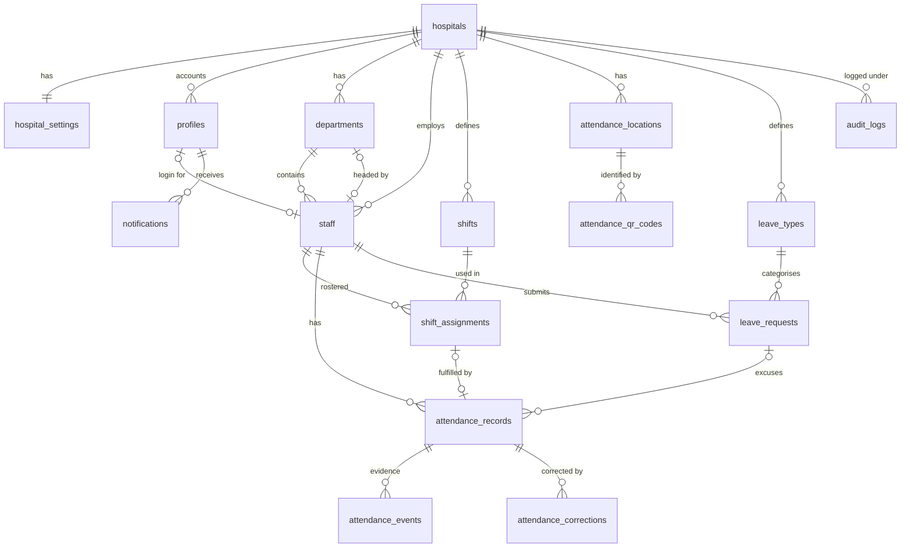

# Phase 1 — Database & Authorization Design

> **Partly superseded.** The system now serves a single hospital, staff clock in at registered terminals instead of scanning QR codes, and leave management has been removed. See [02 — Single hospital, attendance terminals, no leave](02-single-hospital-and-terminals.md) for what changed and which sections below no longer apply.

**Status:** Proposal, awaiting approval. No migrations have been written yet.
**Target:** Supabase (PostgreSQL 15+), Supabase Auth, Supabase Storage, Next.js App Router.

---

## 1. Key architectural decisions

| # | Decision | Rationale |
|---|----------|-----------|
| D1 | **Multi-tenant by `hospital_id`.** Every tenant-owned row carries `hospital_id`. Super Admin is the only cross-tenant role. | One deployment serves many hospitals; isolation is enforced in RLS, not in app code. |
| D2 | **Composite foreign keys for tenant integrity**: each tenant table has `unique (hospital_id, id)`, and child tables reference `(hospital_id, parent_id)`. | The database itself rejects a staff member of Hospital A being assigned a shift of Hospital B, even if app code has a bug. |
| D3 | **Split the spec's "users" into `auth.users` (Supabase) and `public.profiles` (authorization)**, and keep `staff` as the employment record. | Staff can exist before they have a login (HR imports first, invites later). Super Admins have no staff record. |
| D4 | **Department Head is derived, not stored as a role.** A user is a department head if their staff record is `departments.head_staff_id`. | A stored role and a head assignment could disagree. One source of truth means changing the head immediately changes who has access. |
| D5 | **Split the spec's "attendance" into `attendance_records` (one row per shift session) and `attendance_events` (append-only scan log).** | Records are the computed business result. Events are immutable evidence of every scan, including rejected ones, so the original scan times survive any correction. |
| D6 | **The attendance engine lives in PostgreSQL functions (`SECURITY DEFINER` RPCs).** | Check-in must be atomic: validate, lock, check duplicates, compute status and insert in one transaction. supabase-js has no client transactions. The DB is the final security boundary, so calling the RPC directly cannot bypass rules. Server time is `now()`, identity is `auth.uid()`, and nothing timing-related comes from the client. |
| D7 | **No client role can write to attendance, corrections, leave state, QR codes or audit logs directly.** Writes happen only through RPCs. Plain CRUD master data (departments, shifts, staff, locations, leave types, roster) is written directly under RLS. | Rule of thumb: **state machines go through RPCs, master data goes through RLS.** This keeps the RPC surface small (KISS) and keeps workflows impossible to bypass. |
| D8 | **Shifts are defined by `start_time + duration_minutes`**, not start/end times. | This removes the ambiguity of overnight shifts (is `23:00 → 07:00` negative?). Overnight is simply `start + duration > 24h`. |
| D9 | **The roster is stored as dated `shift_assignments` rows with materialised `starts_at` / `ends_at` (`timestamptz`)**, computed in the hospital's timezone. | The engine never does date arithmetic at scan time. An overnight shift is just a time range. An exclusion constraint prevents overlapping shifts for the same person. Bulk "assign Mon–Fri for a month" is a UI operation that inserts rows, so no recurrence rules are needed. |
| D10 | **Attendance records snapshot the schedule and policy values they were judged by** (scheduled start/end, grace minutes, break, thresholds). | A record explains itself. Editing a shift template later never silently changes historical results. Recalculations (checkout, corrections, leave approval) reuse the record's own snapshot. |
| D11 | **Status is never set by hand.** It is always derived from times plus approved leave by one shared function. Corrections change *times*, not status. | Prevents "just mark them present" edits and keeps DRY: one calculation used by checkout, corrections, leave approval and the scheduled job. |
| D12 | **QR codes identify a location through an opaque, versioned token** (`v1.<random>`), never through IDs or staff data. | The server resolves the token. A version prefix lets rotating tokens (`v2.…`) be added later without changing the RPC signature. |
| D13 | **Audit logging uses a generic row trigger plus a transaction-local reason** (`app.audit_reason`). | Every change to a sensitive table is captured with before/after data automatically, so nothing can be modified silently, even by a future code path that forgets to log. |
| D14 | **Service-role key is used only in a `server-only` module for Supabase Auth admin operations** (inviting and disabling users). | Everything else runs with the user's JWT, so RLS always applies. |

---

## 2. Identity & roles

### 2.1 Roles

```
app_role enum: super_admin | hospital_admin | staff
```

| Effective role | How it is determined | Scope |
|----------------|----------------------|-------|
| Super Admin | `profiles.role = 'super_admin'` (and `hospital_id IS NULL`) | All hospitals |
| Hospital Admin / HR | `profiles.role = 'hospital_admin'` | Own hospital |
| Department Head | role is `staff` or `hospital_admin` **and** linked staff record is `head_staff_id` of ≥1 department | Staff and attendance of the department(s) they head |
| Staff | linked, active `staff` record | Self |

A Hospital Admin can also be a staff member who checks in, and can also head a department. Capabilities are the union.

### 2.2 Account lifecycle

1. Public sign-up is **disabled** in Supabase Auth. Accounts are created by invitation only.
2. A Hospital Admin invites a staff member from the app. **The database authorizes the invitation, not the server action**: `prepare_account_invitation(staff_id, role)` verifies the caller administers that hospital and that the staff record is active, has an email address and no account, then records a short-lived row in `account_invitations` (§5.17). The server then calls `auth.admin.inviteUserByEmail` with the secret key purely to send the email.
   *Revised during Phase 4:* Supabase's invite API can only set `user_metadata`, which users can edit themselves, so it must never carry a role. `app_metadata` remains trusted (only the service role can set it) and is still the path used to bootstrap the first Super Admin.
3. An `AFTER INSERT` trigger on `auth.users` accepts the account only when it carries trusted `app_metadata` **or** matches an unexpired invitation whose email still equals the staff record's. It then creates the `profiles` row, links `staff.user_id` and consumes the invitation, in the same transaction as user creation.
   A second trigger sets `profiles.activated_at` when the invitee confirms their email, which distinguishes an invited account from an active one.
4. Deactivation sets `profiles.is_active = false` **and** bans the user in Auth. Every RLS helper checks `is_active`, so access stops on the next request, even while an old JWT is still valid.
5. Users are never hard-deleted, because attendance history must keep its actor references.

### 2.3 Why not custom JWT claims for role and hospital?

Custom access-token hooks avoid a table lookup in RLS, but claims stay stale until the token refreshes (up to 1 hour). For an attendance and HR system, **immediate revocation matters more** than saving an indexed primary-key lookup. The RLS helpers are `STABLE` and wrapped in `(select …)`, so Postgres evaluates them once per statement, not once per row.

---

## 3. Entity relationship overview



---

## 4. Enumerations

Postgres enums are used for **system-defined states**. Hospital-configurable lists (leave types) are tables.

| Enum | Values |
|------|--------|
| `app_role` | `super_admin`, `hospital_admin`, `staff` |
| `staff_status` | `active`, `suspended`, `terminated` |
| `employment_type` | `full_time`, `part_time`, `contract`, `locum`, `intern` |
| `assignment_status` | `scheduled`, `cancelled` |
| `attendance_status` | `present`, `late`, `absent`, `on_leave`, `off_day`, `half_day` |
| `attendance_flag` | `unscheduled`, `missed_check_out`, `leave_conflict`, `outside_geofence` |
| `scan_type` | `check_in`, `check_out` |
| `scan_outcome` | `accepted`, `rejected` |
| `qr_kind` | `static` *(later: `rotating`)* |
| `request_status` | `pending`, `approved`, `rejected`, `cancelled` |
| `half_day_period` | `first_half`, `second_half` |
| `geolocation_mode` | `off`, `record`, `enforce` |
| `notification_type` | `leave_submitted`, `leave_reviewed`, `correction_submitted`, `correction_reviewed`, `missed_check_out`, `marked_absent` |

### How the eight required attendance outcomes are represented

The eight outcomes in the spec overlap: a person can be **late and still work overtime**, or arrive **on time and leave early**. Forcing them into one status column would lose information.

| Spec outcome | Representation |
|--------------|----------------|
| Present, Late, Absent, On Leave, Half Day | `attendance_records.status` (primary day outcome) |
| Off Day | `attendance_status = 'off_day'`, **produced by the reporting function** for staff with no roster assignment that day. It is not stored as a row, which avoids millions of "nothing happened" records. A check constraint keeps it out of stored rows. |
| Early Leave | `early_leave_minutes` + generated `is_early_leave` |
| Overtime | `overtime_minutes` + generated `is_overtime` |

`is_late` is also a generated column, so lateness stays visible in reports when `half_day` becomes the primary status.

---

## 5. Tables

Conventions for every table:
- `id uuid primary key default gen_random_uuid()`, except high-volume append-only tables, which use `bigint generated always as identity`.
- `created_at timestamptz not null default now()`; mutable tables also get `updated_at`, maintained by trigger.
- All instants are `timestamptz`. `date` is used only for business dates in the hospital's local timezone.
- Foreign keys use `on delete restrict` unless stated otherwise. Master data is deactivated (`is_active`), never deleted.
- Every foreign-key column used in joins or policies is indexed. Postgres does not index FKs automatically.

### 5.1 `hospitals`

| Column | Type | Constraints |
|---|---|---|
| id | uuid | PK |
| name | text | not null, length 2–200 |
| code | text | not null, **unique**, `~ '^[A-Z0-9-]{2,20}$'` |
| timezone | text | not null; IANA name validated against `pg_timezone_names` by trigger |
| address, phone, email | text | nullable |
| is_active | boolean | not null default true |
| created_at, updated_at | timestamptz | |

### 5.2 `hospital_settings` (1:1)

Typed columns, not `jsonb`, so every setting is validated by the database.

| Column | Type | Default | Meaning |
|---|---|---|---|
| hospital_id | uuid | PK, FK → hospitals `on delete cascade` | |
| allow_unscheduled_check_in | boolean | false | Accept check-in without a roster entry (flagged `unscheduled` for HR review) |
| min_session_minutes | int | 10 | Minimum gap between check-in and check-out (prevents accidental double scans). Check 0–120 |
| check_out_window_minutes | int | 480 | How long after scheduled end a check-out is still accepted before the session is auto-closed as `missed_check_out`. Check 60–1440 |
| half_day_threshold_percent | int | 50 | Worked time below this % of scheduled net time → `half_day`. Check 1–99 |
| geolocation_mode | geolocation_mode | `off` | `record` stores client-reported position as evidence; `enforce` rejects scans outside the location geofence (spoofable, see §10) |
| updated_at | timestamptz | | |

A row is created by trigger when a hospital is inserted.

### 5.3 `profiles`

| Column | Type | Constraints |
|---|---|---|
| id | uuid | PK, FK → `auth.users(id)` `on delete cascade` |
| hospital_id | uuid | nullable, FK → hospitals |
| role | app_role | not null default `staff` |
| display_name | text | not null |
| is_active | boolean | not null default true |
| activated_at | timestamptz | nullable; set when the invited user confirms their email |
| created_at, updated_at | | |

- `check ((role = 'super_admin') = (hospital_id is null))`
- `unique (hospital_id, id)` (target for the composite FK from staff)
- index `(hospital_id, role)`

### 5.4 `departments`

| Column | Type | Constraints |
|---|---|---|
| id, hospital_id | uuid | `unique (hospital_id, id)` |
| name | text | not null; unique index `(hospital_id, lower(name))` |
| code | text | not null; `unique (hospital_id, code)` |
| description | text | |
| head_staff_id | uuid | nullable; FK `(hospital_id, head_staff_id)` → `staff(hospital_id, id)` |
| is_active | boolean | default true |

- index `(head_staff_id)`, which the department-head RLS helper uses.
- The `departments ↔ staff` relationship is circular but both sides are nullable or insertable in order (create department → create staff → set head).

### 5.5 `staff`

| Column | Type | Constraints |
|---|---|---|
| id, hospital_id | uuid | `unique (hospital_id, id)` |
| user_id | uuid | nullable, **unique**; FK `(hospital_id, user_id)` → `profiles(hospital_id, id)` |
| department_id | uuid | not null; FK `(hospital_id, department_id)` → departments |
| employee_number | text | not null; `unique (hospital_id, employee_number)` |
| first_name, last_name | text | not null |
| email | text | nullable; unique index `(hospital_id, lower(email)) where email is not null` |
| phone | text | |
| job_title | text | not null |
| employment_type | employment_type | not null |
| status | staff_status | not null default `active` |
| hire_date | date | not null |
| termination_date | date | `check (termination_date is null or termination_date >= hire_date)`; `check ((status = 'terminated') = (termination_date is not null))` |
| photo_path | text | Storage object path |

Indexes: `(hospital_id, department_id)`, `(hospital_id, status)`.

The composite FK on `user_id` guarantees a login can only be linked to staff of the same hospital.

### 5.6 `shifts` (templates)

| Column | Type | Default / Constraints |
|---|---|---|
| id, hospital_id | uuid | `unique (hospital_id, id)` |
| department_id | uuid | nullable (null = hospital-wide); composite FK |
| name, code | text | `unique (hospital_id, code)` |
| start_time | time | not null |
| duration_minutes | int | not null, check 30–1440 |
| break_minutes | int | 0; `check (break_minutes >= 0 and break_minutes < duration_minutes)` |
| late_grace_minutes | int | 10; check 0–120 |
| early_leave_grace_minutes | int | 10; check 0–120 |
| overtime_threshold_minutes | int | 30; check 0–240 (minimum minutes past end before overtime counts) |
| check_in_opens_minutes | int | 60; check 0–240 (how early before start a check-in is accepted) |
| crosses_midnight | boolean | **generated**: `extract(hour from start_time)*60 + extract(minute from start_time) + duration_minutes > 1440` |
| is_active | boolean | true |

### 5.7 `shift_assignments` (roster)

| Column | Type | Constraints |
|---|---|---|
| id, hospital_id | uuid | `unique (hospital_id, id)` |
| staff_id | uuid | composite FK → staff |
| shift_id | uuid | composite FK → shifts |
| work_date | date | not null — local date the shift **starts** |
| starts_at | timestamptz | not null — set by trigger: `(work_date + start_time) at time zone hospital.timezone` |
| ends_at | timestamptz | not null — set by trigger: `starts_at + duration` |
| status | assignment_status | default `scheduled` |
| notes | text | |
| created_by | uuid | FK → profiles |

Constraints:
```sql
check (ends_at > starts_at),
exclude using gist (
  staff_id with =,
  tstzrange(starts_at, ends_at, '[)') with &&
) where (status = 'scheduled')          -- requires btree_gist
```
The exclusion constraint allows double shifts and back-to-back shifts but **rejects overlapping ones**. It also rules out assigning the same shift twice on the same date.

Indexes: `(hospital_id, work_date)`, `(staff_id, starts_at)` (engine lookup), `(shift_id)`.

`starts_at` / `ends_at` are protected from direct updates. If a shift template's time changes, an explicit, audited RPC recalculates **future, unattended** assignments only.

### 5.8 `attendance_locations`

| Column | Type | Constraints |
|---|---|---|
| id, hospital_id | uuid | `unique (hospital_id, id)` |
| name | text | unique index `(hospital_id, lower(name))` |
| description | text | |
| latitude, longitude | numeric(9,6) | nullable |
| geofence_radius_m | int | nullable, check 10–5000 |
| is_active | boolean | true |

`check (num_nulls(latitude, longitude, geofence_radius_m) in (0, 3))`: either the geofence is fully defined or not defined at all.

### 5.9 `attendance_qr_codes`

| Column | Type | Constraints |
|---|---|---|
| id, hospital_id | uuid | |
| location_id | uuid | composite FK → attendance_locations |
| kind | qr_kind | default `static` |
| token | text | not null, **unique**; generated in the DB: `'v1.' || base64url(gen_random_bytes(32))` |
| valid_from | timestamptz | default now() |
| valid_until | timestamptz | nullable |
| revoked_at | timestamptz | nullable |
| revoked_by, created_by | uuid | FK → profiles |

- `unique (location_id) where revoked_at is null`: one active code per location. Regenerating revokes the previous code in the same transaction.
- The QR image encodes `https://<app-host>/attendance/scan?c=<token>`. If scanned with the phone's native camera it opens the app; the in-app scanner extracts `c`.
- The token is stored in plaintext because admins must be able to reprint it, and it is physically posted on a wall anyway. It is readable **only** by Hospital/Super Admins. See §10 for why this token is not the anti-fraud control.

### 5.10 `attendance_records` (one row per attendance session)

| Column | Type | Notes |
|---|---|---|
| id, hospital_id | uuid | `unique (hospital_id, id)` |
| staff_id | uuid | composite FK → staff |
| department_id | uuid | **snapshot** of the staff member's department when the record was created (reports stay correct after transfers) |
| shift_assignment_id | uuid | nullable, **unique**; composite FK |
| work_date | date | not null — shift start date (overnight checkout stays in the same session) |
| scheduled_start, scheduled_end | timestamptz | snapshot; null only for unscheduled sessions |
| break_minutes, late_grace_minutes, early_leave_grace_minutes, overtime_threshold_minutes, half_day_threshold_percent | int | policy snapshot |
| check_in_at, check_out_at | timestamptz | server time only |
| check_in_location_id, check_out_location_id | uuid | composite FKs |
| status | attendance_status | not null |
| late_minutes | int | not null default 0, ≥ 0 |
| early_leave_minutes | int | not null default 0, ≥ 0 |
| overtime_minutes | int | not null default 0, ≥ 0 |
| worked_minutes | int | nullable until checkout, ≥ 0 |
| is_late | boolean | **generated**: `late_minutes > late_grace_minutes` |
| is_early_leave | boolean | **generated**: `early_leave_minutes > early_leave_grace_minutes` |
| is_overtime | boolean | **generated**: `overtime_minutes >= overtime_threshold_minutes and overtime_minutes > 0` |
| flags | attendance_flag[] | not null default `'{}'` |
| leave_request_id | uuid | nullable FK — set when status is `on_leave` |
| last_correction_id | uuid | nullable FK — set when an approved correction was applied |
| closed_at | timestamptz | null while the session is open |
| created_at, updated_at | | |

Constraints:
```sql
check (status <> 'off_day'),
check ((check_in_at is null) = (status in ('absent', 'on_leave'))),
check (check_out_at is null or (check_in_at is not null and check_out_at > check_in_at)),
check (shift_assignment_id is not null or 'unscheduled' = any(flags)),
check (status <> 'on_leave' or leave_request_id is not null)
```

Indexes:
- `unique (staff_id) where closed_at is null`: **at most one open session per staff member**. This is the final guarantee against double check-in races.
- `(hospital_id, work_date, status)`: daily dashboard and reports
- `(department_id, work_date)`: department head views
- `(staff_id, work_date desc)`: personal history
- `(hospital_id, work_date) where flags <> '{}'`: HR review queue

### 5.11 `attendance_events` (append-only scan log)

| Column | Type | Notes |
|---|---|---|
| id | bigint identity | PK |
| user_id | uuid | not null — the authenticated caller |
| hospital_id, staff_id | uuid | nullable (a scan by a user with no staff record is still logged) |
| attendance_record_id | uuid | nullable (null for rejected scans) |
| scan_type | scan_type | |
| outcome | scan_outcome | |
| rejection_code | text | e.g. `QR_INVALID`, `QR_REVOKED`, `NO_SHIFT`, `ALREADY_CHECKED_IN`, `WRONG_HOSPITAL`, `TOO_SOON` |
| qr_code_id, location_id | uuid | nullable |
| occurred_at | timestamptz | default `now()` |
| ip_address | inet | untrusted context |
| user_agent | text | untrusted context |
| latitude, longitude, accuracy_m | numeric | **client-reported, evidence only** |

Indexes: `(attendance_record_id)`, `(hospital_id, occurred_at desc)`, `(staff_id, occurred_at desc)`, `(hospital_id, occurred_at desc) where outcome = 'rejected'` (security monitoring).

UPDATE and DELETE are blocked by trigger and privileges are revoked. The check-in RPC **returns** a rejection result instead of raising an error, so the rejected-attempt row is committed.

### 5.11a `attendance_overview` view *(added in Phase 5)*

A `security_invoker` view joining `attendance_records` to the staff member, department, shift and the locations scanned, so list pages read one relation while every underlying table still applies the caller's RLS. Used by personal history, the daily attendance view and (later) reports.

### 5.12 `attendance_corrections`

| Column | Type | Constraints |
|---|---|---|
| id, hospital_id | uuid | |
| attendance_record_id | uuid | not null, composite FK |
| staff_id | uuid | not null (subject of the correction) |
| requested_by | uuid | FK → profiles (staff member or admin) |
| requested_check_in_at | timestamptz | nullable |
| requested_check_out_at | timestamptz | nullable |
| reason | text | not null, length ≥ 10 |
| evidence_path | text | *Deferred: added with the Storage work, alongside the upload flow* |
| status | request_status | default `pending` |
| reviewed_by | uuid | FK → profiles |
| reviewed_at | timestamptz | |
| review_note | text | required when rejecting |
| created_at, updated_at | | |

- `check (num_nonnulls(requested_check_in_at, requested_check_out_at) >= 1)`
- `check (requested_check_out_at is null or requested_check_in_at is null or requested_check_out_at > requested_check_in_at)`
- `unique (attendance_record_id) where status = 'pending'`: one open request per record
- `check ((status in ('approved','rejected')) = (reviewed_by is not null and reviewed_at is not null))`
- Indexes: `(hospital_id, status, created_at desc)`, `(staff_id, created_at desc)`

Before/after values are **not** duplicated here. The audit log stores them, and the original scan times remain in `attendance_events`.

Every past rostered shift has a record: the scheduled job creates `absent` records. That is why a correction always targets an existing record.

### 5.13 `leave_types`

| Column | Type | Constraints |
|---|---|---|
| id, hospital_id | uuid | `unique (hospital_id, id)` |
| name, code | text | `unique (hospital_id, code)` |
| is_paid | boolean | |
| requires_attachment | boolean | default false |
| allows_half_day | boolean | default false |
| max_days_per_year | numeric(5,1) | nullable (null = unlimited) |
| is_active | boolean | |

### 5.14 `leave_requests`

| Column | Type | Constraints |
|---|---|---|
| id, hospital_id | uuid | |
| staff_id | uuid | composite FK |
| leave_type_id | uuid | composite FK |
| start_date, end_date | date | `check (end_date >= start_date)` |
| half_day_period | half_day_period | nullable; `check (half_day_period is null or start_date = end_date)` |
| days | numeric(5,1) | **generated**: `case when half_day_period is not null then 0.5 else (end_date - start_date + 1) end` |
| reason | text | not null |
| attachment_path | text | *Deferred: added with the Storage work, alongside the upload flow* |
| status | request_status | default `pending` |
| reviewed_by, reviewed_at, review_note | | as corrections |
| created_at, updated_at | | |

```sql
exclude using gist (
  staff_id with =,
  daterange(start_date, end_date, '[]') with &&
) where (status in ('pending', 'approved'))
```
Indexes: `(hospital_id, status, start_date)`, `(staff_id, start_date desc)`.

v1 has no balance table. Usage is computed from approved requests against `max_days_per_year`. A `leave_balances` table (carry-over, accrual) can be added later without changing this table.

### 5.15 `notifications`

| Column | Type | Notes |
|---|---|---|
| id | bigint identity | |
| hospital_id | uuid | nullable |
| recipient_id | uuid | FK → profiles |
| type | notification_type | |
| title, body | text | |
| link_path | text | in-app route |
| entity_table, entity_id | text | |
| read_at | timestamptz | nullable |
| created_at | | |

Indexes: `(recipient_id, created_at desc)`, `(recipient_id) where read_at is null`.

### 5.16 `audit_logs` (append-only)

| Column | Type | Notes |
|---|---|---|
| id | bigint identity | |
| hospital_id | uuid | nullable (platform-level actions) |
| actor_id | uuid | nullable = system/job. **No FK**, so audit rows never change when accounts change |
| actor_role | text | snapshot |
| action | text | `insert` / `update` / `delete` from the trigger, or semantic: `attendance.check_in`, `correction.approve`, `leave.approve`, `qr.regenerate` |
| entity_table | text | |
| entity_id | text | |
| old_data, new_data | jsonb | |
| reason | text | from `current_setting('app.audit_reason', true)` |
| context | jsonb | source (`rpc` / `trigger` / `job`), request IP, user agent |
| created_at | timestamptz | |

Indexes: `(hospital_id, created_at desc)`, `(entity_table, entity_id, created_at desc)`, `(actor_id, created_at desc)`.

Audited tables: `hospitals`, `hospital_settings`, `profiles`, `departments`, `staff`, `shifts`, `shift_assignments`, `account_invitations`, `attendance_locations`, `attendance_qr_codes`, `attendance_records`, `attendance_corrections`, `leave_types`, `leave_requests`.

### 5.17 `account_invitations` *(added in Phase 4)*

Bridges the authorization decision and the Supabase Auth call that follows it, so an account can never be provisioned without a hospital admin's decision.

| Column | Type | Notes |
|---|---|---|
| id, hospital_id | uuid | |
| staff_id | uuid | composite FK → staff |
| email | text | not null, lower-cased; matched against the new `auth.users` row |
| role | app_role | `hospital_admin` or `staff` only |
| invited_by | uuid | FK → profiles |
| expires_at | timestamptz | default `now() + 15 minutes` |
| accepted_at, user_id | | set when the trigger consumes the invitation |
| created_at | | |

Indexes: `(email) where accepted_at is null`, `(staff_id, created_at desc)`. Readable by admins of the hospital; writable only through `prepare_account_invitation`.

UPDATE/DELETE are blocked by trigger, privileges are revoked from `anon`, `authenticated` and `service_role`, and there are no write policies.

---

## 6. Attendance engine

### 6.1 Shared calculation (single source of truth)

`private.compute_attendance_outcome(record)` is used by check-out, correction approval, leave approval and the scheduled job:

```
net_scheduled   = (scheduled_end - scheduled_start) - break_minutes

late_minutes        = max(0, floor((check_in_at  - scheduled_start) / 1 min))
early_leave_minutes = max(0, floor((scheduled_end - check_out_at)   / 1 min))   -- if checked out
overtime_minutes    = max(0, floor((check_out_at  - scheduled_end)  / 1 min))   -- if checked out
worked_minutes      = max(0, floor((check_out_at  - check_in_at)    / 1 min) - break_minutes)

status =
  check_in_at is null  and approved leave covers work_date   → on_leave
  check_in_at is null                                        → absent
  worked_minutes < net_scheduled × half_day_threshold% 
     or approved half-day leave covers work_date            → half_day
  late_minutes > late_grace_minutes                          → late
  otherwise                                                  → present
```
Policy choices (flagged in §12): arriving early counts toward worked time but **not** toward overtime; overtime counts only after scheduled end.

### 6.2 `public.check_in(p_payload text, p_client jsonb)`

`SECURITY DEFINER`, `set search_path = ''`, `EXECUTE` granted to `authenticated` only.

1. `uid := auth.uid()`; reject if null.
2. Load the active profile, active staff record and active hospital for `uid`. **Lock the staff row `FOR UPDATE`**, which serialises concurrent scans by the same person.
3. Parse the payload → token. Resolve `attendance_qr_codes` where the token matches, `revoked_at is null`, and `now()` is within the validity window. Load the active location. Reject if `location.hospital_id <> staff.hospital_id`.
4. If `geolocation_mode = 'enforce'` and the location has a geofence: reject if the client-reported position is missing or outside it. In `record` mode, store it and flag `outside_geofence`.
5. Reject if the staff member has an open session (`closed_at is null`) → `ALREADY_CHECKED_IN`.
6. Find the candidate assignment: `status = 'scheduled'`, no attendance record yet, and `now() between starts_at - check_in_opens_minutes and ends_at`. If several match (back-to-back shifts), pick the one whose `starts_at` is **closest to now**.
7. If none matches: when `allow_unscheduled_check_in`, create an unscheduled session (flag `unscheduled`); otherwise reject with `NO_SHIFT`.
8. If approved leave covers `work_date`, allow it (recall from leave) and flag `leave_conflict`.
9. Insert the `attendance_records` row with the snapshot values, `check_in_at = now()`, and status `present`/`late`.
10. Insert the accepted `attendance_events` row. The audit trigger fires.
11. Return `{ ok, record_id, status, late_minutes, scheduled_start, scheduled_end, location_name }`.

On any validation failure: insert a rejected event and return `{ ok: false, code }`. Unique-violation errors on the partial indexes are caught and mapped to `ALREADY_CHECKED_IN` (the final defence against double taps).

### 6.3 `public.check_out(p_payload text, p_client jsonb)`

Steps 1–4 as above, then:

5. Load the open session for the staff member, or reject with `NO_OPEN_SESSION`.
6. Reject if `now() - check_in_at < min_session_minutes` → `TOO_SOON`.
7. Reject if `now() > scheduled_end + check_out_window_minutes` → `CHECK_OUT_WINDOW_CLOSED`. The staff member must request a correction.
8. Set `check_out_at = now()`, `check_out_location_id` and `closed_at = now()`; recompute via §6.1; insert the event.

### 6.4 Overnight example

Shift *Night* `start_time 23:00`, `duration 480`, `break 30`, grace 10, overtime threshold 30, hospital TZ `Africa/Accra`.

| Step | Value |
|---|---|
| Assignment | `work_date 2026-09-14`, `starts_at 2026-09-14 23:00`, `ends_at 2026-09-15 07:00` |
| Check-in accepted from | 2026-09-14 22:00 |
| Scan in 23:07 | `late_minutes 7` ≤ grace → `present` |
| Scan out 2026-09-15 07:40 | open session found regardless of calendar date; `overtime_minutes 40` → `is_overtime`; `worked_minutes 483` |
| Reported under | **2026-09-14** (`work_date`) |

Timezones: `starts_at` is computed from the local wall-clock time in the hospital's IANA zone. On a DST transition night, an 8-hour-duration shift ends one wall-clock hour earlier or later. This is acceptable and documented, and has no effect in zones without DST.

### 6.5 Scheduled job — `private.finalize_elapsed_shifts()` (pg_cron, every 10 minutes)

Idempotent; the unique constraints make re-runs harmless.

1. For each `scheduled` assignment with `ends_at < now()` and no record: insert `on_leave` (with `leave_request_id`) if approved leave covers the date, otherwise `absent`. Notify the staff member and their department head for `absent`.
2. For each open session past `scheduled_end + check_out_window_minutes` (unscheduled sessions: `check_in_at + check_out_window_minutes + 16h`): set `closed_at = now()` and add flag `missed_check_out`. **`check_out_at` stays null**, because no checkout time is invented. Notify the staff member.

All job writes are audited with `actor_id = null`, `context.source = 'job'`.

*Implemented in Phase 5; completed in Phase 6:* the job now records `on_leave` (with `attendance_records.leave_request_id`) when approved leave covers the work date, and `absent` otherwise. Approving leave retroactively also converts absences already recorded inside its dates, and withdrawing it converts them back. The `leave_conflict` flag, for someone who checks in while on approved leave, is still unused.

### 6.6 Correction approval — `public.review_attendance_correction(id, decision, note)`

1. The caller must be permitted to review (§8.3) and must **not** be the subject staff member.
2. Lock the correction and its record. The correction must be `pending`.
3. On approval: `set_config('app.audit_reason', note, true)`, apply the requested times to the record, remove `missed_check_out` if a checkout time is now present, set `closed_at` if needed, recompute via §6.1, set `last_correction_id`.
4. Update the correction status and notify the requester.

An admin-initiated correction is created and approved in one call with a mandatory reason. It remains a separate, visible correction row.

### 6.7 Leave approval side effects

When leave is approved after the fact (for example retroactive sick leave), existing `absent` records inside the range are recomputed to `on_leave` in the same transaction, with the leave request as the audit reason. If a leave approval is later cancelled, the affected records are recomputed back. Nothing changes silently: every change produces audit rows.

---

## 7. QR design

### v1 — static codes
- One active code per location, printed and posted.
- Payload: `v1.<43-char base64url of 32 random bytes>` inside an app URL.
- Revoking or regenerating takes effect immediately.
- 256-bit tokens make guessing infeasible. Rejected attempts are logged and rate-limited at the Next.js layer.

### Later — rotating codes (design allowance only, not built)
- Add `qr_kind = 'rotating'` with columns `secret bytea` and `rotation_seconds int` on `attendance_qr_codes`. The secret is never selectable through RLS.
- A kiosk screen at the location displays `v2.<qr_code_id>.<time_window>.<hmac(secret, id‖window)>`, refreshed every N seconds.
- `private.resolve_qr_token(text)` dispatches on the prefix. `check_in` / `check_out` signatures and all tables stay unchanged.
- Kiosk device authentication (a device-scoped credential) is a separate design item for that phase.

---

## 8. Authorization model

### 8.1 Capability matrix

`R` read · `W` create/update via RLS · `RPC` only through a function · `—` none
*(HA = Hospital Admin, own hospital; DH = Department Head, own departments; ST = Staff, self)*

| Resource | Super Admin | HA | DH | ST |
|---|---|---|---|---|
| hospitals | R W | R (own) | R (own) | R (own) |
| hospital_settings | R W | R W | R | R |
| profiles | R, RPC | R (hospital), RPC | — | R (self), W display_name |
| departments | R W | R W | R | R |
| staff | R W | R W | R (dept) | R (self) |
| shifts | R W | R W | R | R |
| shift_assignments | R W | R W | R (dept) | R (self) |
| attendance_locations | R W | R W | R | R |
| attendance_qr_codes | R, RPC | R, RPC | — | — |
| attendance_records | R | R | R (dept) | R (self); check-in/out via RPC |
| attendance_events | R | R | — | R (self) |
| attendance_corrections | R, RPC | R, RPC review | R (dept), RPC request | R (self), RPC request/cancel |
| leave_types | R W | R W | R | R |
| leave_requests | R, RPC | R, RPC review | R (dept), RPC review | R (self), RPC submit/cancel |
| notifications | own | own | own | own (mark read) |
| audit_logs | R | R (hospital) | — | — |

No role has DELETE on any table. Deactivation, cancellation and revocation are state changes.

### 8.2 Helper functions (schema `private`, not exposed by the Data API)

All of them: `language sql stable security definer set search_path = ''`. `EXECUTE` is granted to `authenticated` and revoked from `public` and `anon`. Each one returns nothing for inactive profiles, inactive hospitals or non-active staff.

| Function | Returns |
|---|---|
| `private.is_super_admin()` | boolean |
| `private.user_hospital_id()` | caller's hospital id (any role) |
| `private.admin_hospital_id()` | hospital id if the caller is an active `hospital_admin`, else null |
| `private.user_staff_id()` | caller's active staff id |
| `private.headed_department_ids()` | `uuid[]` of departments the caller heads |

```sql
create function private.user_hospital_id()
returns uuid
language sql stable security definer set search_path = ''
as $$
  select p.hospital_id
  from public.profiles p
  join public.hospitals h on h.id = p.hospital_id
  where p.id = (select auth.uid())
    and p.is_active
    and h.is_active
$$;
```

### 8.3 Policy patterns

One permissive policy per table and command, combining clauses with `OR`. Multiple permissive policies are each evaluated, which is slower. Helpers are always wrapped in `(select …)` so they run once per statement.

```sql
-- Tenant-wide read (departments, shifts, locations, leave_types, hospital_settings)
using ( (select private.is_super_admin())
        or hospital_id = (select private.user_hospital_id()) )

-- Master-data write (insert / update)
using      ( (select private.is_super_admin()) or hospital_id = (select private.admin_hospital_id()) )
with check ( (select private.is_super_admin()) or hospital_id = (select private.admin_hospital_id()) )

-- Hierarchical read (attendance_records)
create policy attendance_records_select on public.attendance_records
for select to authenticated
using (
  (select private.is_super_admin())
  or hospital_id   = (select private.admin_hospital_id())
  or department_id = any ((select private.headed_department_ids())::uuid[])
  or staff_id      = (select private.user_staff_id())
);

-- Dept-scoped read on tables without department_id (shift_assignments, leave_requests)
or exists (
  select 1 from public.staff s
  where s.id = staff_id
    and s.department_id = any ((select private.headed_department_ids())::uuid[])
)
```

**Who reviews what** (see open decision Q3):
- Leave requests: Hospital Admin (any staff in hospital) or Department Head (staff in their departments).
- Attendance corrections: Hospital Admin only. Department Heads can view them.
- Nobody can review a request about themselves (enforced inside the RPC).

### 8.4 Grants (defense in depth beyond RLS)

- `revoke all on all tables in schema public from anon`: this system has no anonymous access.
- `revoke insert, update, delete` from `authenticated` on `attendance_records`, `attendance_events`, `attendance_corrections`, `leave_requests`, `attendance_qr_codes`, `notifications` (except `update (read_at)`), `audit_logs` and `profiles` (except `update (display_name)`).
- `enable row level security` on **every** public table, with no exceptions.
- Reporting views are created `with (security_invoker = true)`. Without it, a view runs as its owner and **bypasses RLS**.

### 8.5 RPC surface (public schema, `authenticated` only)

| RPC | Purpose |
|---|---|
| `check_in`, `check_out` | QR attendance |
| `request_attendance_correction`, `review_attendance_correction`, `cancel_attendance_correction` | Corrections workflow |
| `submit_leave_request`, `review_leave_request`, `cancel_leave_request` | Leave workflow |
| `generate_location_qr_code`, `revoke_location_qr_code` | QR management |
| `update_account_access(user_id, role, is_active)` | Role changes. HA cannot grant `super_admin`, cannot modify themselves, cannot act outside their hospital |
| `prepare_account_invitation(staff_id, role)` | Authorizes an invitation and returns the address to send it to |
| `change_staff_status(staff_id, status, reason, effective_date)` | Suspend, terminate or reactivate a staff record; requires a reason, disables the account and cancels future rostered shifts |
| `create_shift_assignments(shift_id, staff_ids[], work_dates[])` | Bulk rostering; runs as the caller so RLS authorizes every row, and reports overlaps it skipped |
| `report_attendance_summary(...)`, `report_attendance_by_day(...)` | Reporting. **Not** `SECURITY DEFINER`: they run as the caller, so RLS decides what each report covers. Return JSON, validated against a schema in the app |
| `reschedule_future_assignments(shift_id)` | Apply a shift time change to future unattended assignments |
| `report_daily_attendance(hospital_id, date)` / range variants | Produces `off_day` and "not yet checked in"; runs as invoker so RLS applies |

Every mutating RPC: validates `auth.uid()`, re-checks authorization explicitly (definer functions bypass RLS), locks affected rows, sets `app.audit_reason`, and returns typed error codes that the UI maps to messages.

**Validation layering (not duplication):** Zod validates shape and format on the Next.js server for good error messages. Database constraints and RPCs enforce the business invariants that must hold no matter who calls.

---

## 9. Storage

| Bucket | Visibility | Path | Read | Write |
|---|---|---|---|---|
| `staff-photos` | private | `{hospital_id}/{staff_id}/{uuid}.{ext}` | anyone who can read that staff row | SA, HA |
| `request-attachments` | private | `{hospital_id}/{staff_id}/{leave\|correction}/{uuid}.{ext}` | owner staff, HA, DH of that staff member | owner staff (insert only), HA |

*Built in Phase 7:* the `request-attachments` bucket, with a flatter path than sketched above (`{hospital_id}/{staff_id}/{uuid}.{ext}`, no per-request-type folder, since the database column already says which request a file belongs to). Uploads go through a server action using the user's own session, so these policies apply in addition to the checks in the action. `staff-photos` is not built yet.

- Policies on `storage.objects` compare `(storage.foldername(name))[1]` and `[2]` as **text** against helper results. Casting untrusted path segments to uuid would throw.
- Buckets set `file_size_limit` (photos 2 MB, attachments 10 MB) and `allowed_mime_types` (images, PDF).
- Files are served through short-lived signed URLs. No public URLs.
- Objects are never updated in place; a replacement is a new object, so evidence cannot be swapped silently.

---

## 10. Security considerations & threat model

| Threat | Mitigation | Residual risk |
|---|---|---|
| **Remote check-in with a photographed static QR** | Not preventable with static codes alone. Mitigations: geofence (`record`/`enforce`), rejected-scan monitoring, flags for HR review, rotating kiosk QR (§7) in a later phase | **Static QR proves "has seen the code", not "is physically present".** Browser geolocation is client-reported and spoofable. This limit must be understood by the hospital. |
| Buddy punching (colleague uses someone else's login) | Scans are tied to the authenticated account; device/IP captured as evidence | Needs device binding or selfie verification later; out of v1 scope |
| Client clock or payload tampering | Server `now()` only; the client sends only the QR payload and optional position | — |
| Double check-in / race conditions | Staff row lock + `unique (staff_id) where closed_at is null` + unique assignment per record | — |
| Cross-tenant data access | RLS on every table, composite tenant FKs, `security_invoker` views, storage path policies | — |
| Privilege escalation | No direct `profiles.role` update; RPC checks; `app_metadata` only; HA cannot create super admins or edit themselves | — |
| `SECURITY DEFINER` abuse | `search_path = ''`, schema-qualified names, explicit auth checks, helpers in an unexposed schema, `EXECUTE` revoked from `public`/`anon` | — |
| Service-role leakage | Only in a `server-only` module, only for Auth admin calls, never `NEXT_PUBLIC_*` | — |
| Stale access after deactivation | Helpers check `is_active` on every statement; Auth ban | — |
| Silent modification of attendance | No client write privileges; changes only through audited RPCs; immutable event log; audit trigger | The `postgres` superuser can still bypass. For regulatory-grade guarantees, stream audit logs to external append-only storage later |
| Token brute force | 256-bit tokens, rate limiting at the route handler, rejected-scan logging | — |
| Self-approval / collusion | Reviewer ≠ subject enforced; every review audited with reviewer identity | DH–staff collusion is detectable, not preventable |
| Admin account takeover | Recommend Supabase MFA (TOTP) for `hospital_admin` / `super_admin`; RPCs can require `auth.jwt()->>'aal' = 'aal2'` | See Q8 |

---

## 11. Proposed repository layout (created in Phase 2)

```
supabase/
  config.toml
  migrations/
    <ts>_extensions_enums.sql           -- btree_gist, pgcrypto, pg_cron; all enums
    <ts>_private_schema_audit.sql       -- private schema, updated_at + audit triggers, audit_logs
    <ts>_tenancy_identity.sql           -- hospitals, hospital_settings, profiles, auth trigger, RLS helpers
    <ts>_organization.sql               -- departments, staff (+ RLS)
    <ts>_scheduling.sql                 -- shifts, shift_assignments (+ RLS)
    <ts>_locations_qr.sql               -- attendance_locations, attendance_qr_codes (+ RLS, RPCs)
    <ts>_attendance.sql                 -- records, events, compute function, check_in/check_out (+ RLS)
    <ts>_corrections.sql
    <ts>_leave.sql
    <ts>_notifications.sql
    <ts>_storage.sql
    <ts>_jobs.sql                       -- pg_cron schedules
  tests/                                -- pgTAP: RLS per role, engine scenarios (overnight, late, races)
  seed.sql                              -- local development bootstrap only (one hospital + super admin)
src/
  lib/supabase/{server.ts, browser.ts, admin.ts (server-only)}
  types/database.ts                     -- generated by `supabase gen types`
  features/<module>/{schemas.ts, queries.ts, actions.ts, types.ts}
  app/…                                 -- routes and UI only
```

Each table's RLS policies live in the same migration as the table, so a table never exists without its policies.

**Testing:** pgTAP via `supabase test db` (part of the Supabase CLI, not a new app dependency). Every policy is tested per role, and every engine rule has scenario tests, including overnight shifts, DST, double scans and cross-hospital QR codes.

---

## 12. Open decisions (need your input before Phase 2)

| # | Question | Proposed default |
|---|---|---|
| Q1 | Can one user account belong to **more than one hospital**? (e.g. a locum doctor working at two sites) | **No** in v1: one account, one hospital. A membership table can replace `profiles.hospital_id` later |
| Q2 | Should **Hospital Admin and HR** be separate roles with different permissions? | **One role** (`hospital_admin`) as the spec groups them |
| Q3 | Who may approve **attendance corrections**? | Hospital Admin only; Department Heads approve **leave** for their department |
| Q4 | Allow **unscheduled check-in** (emergency call-ins)? | Hospital setting, default **off** |
| Q5 | Overtime policy: count early arrival? Does overtime need **approval** before it is payable? | Only time after scheduled end counts; no approval workflow in v1 (`is_overtime` is informational) |
| Q6 | Leave **balances** with accrual and carry-over in v1? | **No**; `max_days_per_year` per leave type only |
| Q7 | Anti-fraud expectation for v1: is static QR plus optional geofence acceptable, or should rotating kiosk QR be in v1? | Static + geofence `record` mode in v1; rotating QR in a later phase |
| Q8 | Require **MFA** for admin roles? | Recommended; enforce for `super_admin`, optional per hospital for `hospital_admin` |
| Q9 | Should leave `days` count **calendar days** or only **rostered days**? | Calendar days in v1 (simple, predictable) |
| Q10 | Department **hierarchy** (e.g. Nursing → Ward 3)? | Flat departments in v1 |

---

## 13. Proposed phase plan

| Phase | Scope |
|---|---|
| **1** | *This document* — database and authorization design |
| 2 | Project scaffold, Supabase migrations for tenancy/identity/organization/scheduling, RLS, audit, pgTAP tests, generated types |
| 3 | Authentication (invite-only), app shell, role-aware navigation |
| 4 | Departments, staff, shifts, roster management |
| 5 | Attendance locations, QR generation, attendance engine migrations, check-in/out flow with camera scanning |
| 6 | Attendance history, corrections, leave management, notifications |
| 7 | Dashboards, reports, audit log viewer, settings |
